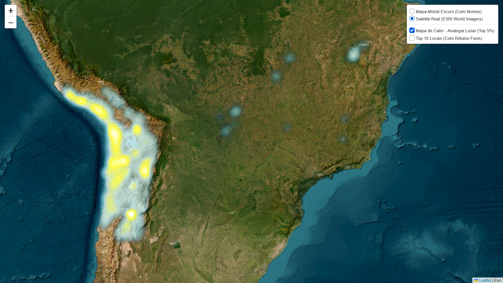
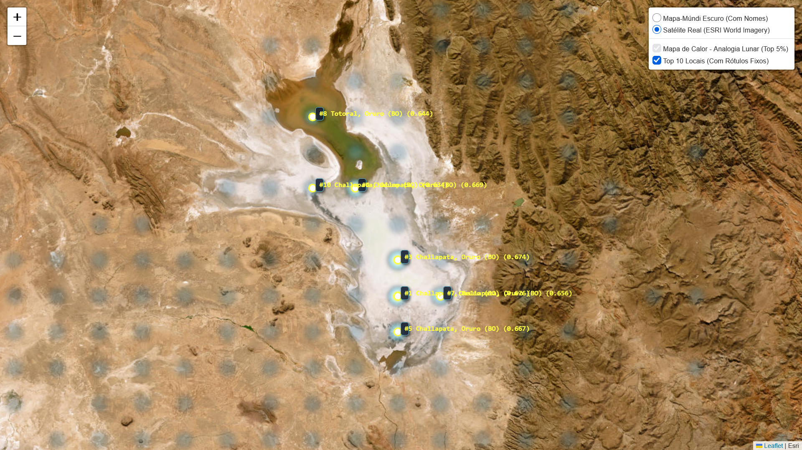

# RedFrontier — Finding a Piece of the Moon in South America

Finding a piece of the Moon on Earth with NASA satellites comes with a special challenge: you have to look for a place as devoid as possible of everything that makes Earth act like Earth—our thick atmosphere, liquid water, weather systems, and vegetation.

Instead of picking planetary test sites because they look like a sci-fi desert in photos, this project uses open NASA Earth observation datasets (**SMAP**, **VIIRS**, **OMPS**, and **EMIT**) processed on a GPU to scan entire continents—or the entire planet—under the exact same physical ruler. When we let the orbital data speak for itself across South America, the algorithm pointed to an overlooked region high in the Bolivian Andes: **Challapata, in the department of Oruro**.

This text covers how to set up and run the code, the science behind every satellite criterion we measure, what the resulting heatmaps reveal about Oruro, a complete step-by-step walkthrough of how the score is computed directly from NASA Earthdata files (including an in-depth guide to **Spatial Non-Maximum Suppression** and the **Haversine distance formula**), and an honest evaluation of how closely Challapata mirrors the lunar surface.

---

## 1. Prerequisites

To run the code cleanly, you need two things ready: a CUDA-capable GPU environment and an authorized NASA Earthdata Login account.

### 1.1 Hardware & Python Environment: CUDA-Capable GPU
Processing multi-sensor NASA HDF5 and NetCDF rasters across continental or global bounding boxes means aligning and averaging millions of pixels in parallel. To keep runtimes practical, the script uses **Dask** (8 parallel CPU threads for file I/O) and offloads raster projections, normalizations, and score math to the GPU via **CuPy** (`cupy` and `cupy-xarray`).

* **Cloud (recommended):** Google Colab with a GPU runtime enabled via `Runtime > Change runtime type > Hardware accelerator > T4 GPU` (or better).
* **Local machine:** An NVIDIA GPU with CUDA drivers installed.
* **Required Python packages** (installed automatically at the top of the notebook):
  ```bash
  pip install earthaccess xarray h5netcdf netCDF4 rioxarray cupy-xarray dask reverse_geocoder folium h5py psutil
  ```
### 1.2 Configuring Your Credentials
* **In Google Colab:** The script reads your credentials automatically from Colab Secrets using `userdata.get("EDL_USERNAME")` and `userdata.get("EDL_PASSWORD")`. Open the key icon (**Secrets**) in the left sidebar, add `EDL_USERNAME` and `EDL_PASSWORD`, and toggle notebook access on.
* **Locally:** Store your credentials in a `.netrc` file in your home directory (`~/.netrc` on Linux/macOS or `C:\Users\<username>\.netrc` on Windows):
  ```text
  machine urs.earthdata.nasa.gov login <your_username> password <your_password>
  ```

> **Tip on speed and RAM:** Near the top of the script, pick your target `bbox` (`lon_min, lat_min, lon_max, lat_max`). Use South America `(-75.0, -30.0, -34.0, -2.0)` for fast runs; global scale `(-180.0, -90.0, 180.0, 90.0)` works too, but requires noticeably more RAM, disk space, and download time.

---

### 1.3 Authorizing the `NASA GESDISC DATA ARCHIVE` App
The pipeline downloads calibrated scientific granules directly from NASA's Distributed Active Archive Centers (DAACs) via the `earthaccess` Python library. A free account is required, and you **must** pre-authorize the GES DISC archive before running automated downloads:

1. Create a free account (or sign in) at **[NASA Earthdata Login](https://urs.earthdata.nasa.gov/)**.
2. In the top navigation bar, click **Applications**, then select **Authorized Apps**.
3. Scroll to the bottom of the page and click **APPROVE MORE APPLICATIONS**.
4. Search for **`NASA GESDISC DATA ARCHIVE`**, select it, click **Approve**, and accept the End User License Agreement (EULA).
5. Confirm that it appears under your **Authorized Apps** list.


## 2. The Science Behind the Criteria: Three Physical Pillars

Whether you are reading this in high school physics or designing lunar hardware, the core idea is the same: **we are not looking for pretty deserts—we are hunting for real-world hardware failure modes.** When engineers test lunar rovers, solar panels, drills, or habitats on Earth, they need ground conditions that stress metal, batteries, optics, and sensors the way the Moon does.

The script pulls **seven NASA Earthdata products across four orbital instruments** and groups them into **three physical pillars**:

### Pillar 1 — Temperature & Albedo (Thermal Shock & Light Absorption)
* **NASA Products:** VIIRS Day/Night Land Surface Temperature (`VNP21A1D`, `VNP21A1N` — `LST_1KM`), SMAP L4 Surface Temperature fallback (`SPL4SMGP` — `surface_temp`), and VIIRS Shortwave Albedo (`VNP43MA3` — `Albedo_BSA_shortwave`).
* **The intuition:** On Earth, the atmosphere acts like a blanket that keeps daytime heat from spiking too high and traps warmth at night. The Moon has no blanket—it sits in vacuum, swinging by more than $250\text{ K}$ between sunlit plains ($> 120^\circ\text{C}$) and shadow ($< -130^\circ\text{C}$). On top of that, the dark plains of the Moon (the basaltic *maria*) have very low reflectivity, absorbing roughly $88\%$ of the sunlight that hits them instead of bouncing it away.
* **The physics:** We track **diurnal thermal amplitude ($\Delta T = T_{\text{day}} - T_{\text{night}}$)** and **shortwave Black-Sky Albedo (BSA)**. Large daily $\Delta T$ exposes mechanical joints, adhesives, electronics, and batteries to cyclic expansion-contraction fatigue. Targeting a dark albedo centered at $0.12$ mimics the optical reflectance and radiative heat absorption of lunar basalt—preventing bright white quartz dunes or blinding salt flats from scoring high just because they are dry.

### Pillar 2 — Soil Desiccation & Biological Sterility (Zero Water, Zero Life)
* **NASA Products:** SMAP L4 Soil Moisture (`SPL4SMGP` — `sm_surface`, `sm_rootzone`, `sm_profile`, `land_fraction_wilting`) and VIIRS 16-Day Vegetation Index (`VNP13A1` — `500 m 16 days NDVI`).
* **The intuition:** Earth is covered in water and plants; the Moon is bone-dry, sterile rock dust (regolith) with zero liquid water and zero chlorophyll.
* **The physics:** Even small traces of liquid water or vegetation wreck a lunar field test. Water has a massive specific heat capacity (muting temperature swings), changes the soil's **dielectric permittivity** (distorting ground-penetrating radar and water-prospecting sensors), and alters mechanical grain cohesion. By combining volumetric soil moisture across three depths—surface ($0$ to $5\text{ cm}$), root zone ($0$ to $100\text{ cm}$), and deep profile—with the **permanent wilting point fraction** (`land_fraction_wilting`, measuring chronic pedological aridity) and the **Normalized Difference Vegetation Index (`NDVI`)**, the algorithm eliminates forests, pastures, and damp basins to isolate dry, exposed mineral ground.

### Pillar 3 — Atmospheric Stability & Mafic Mineralogy (Calm Skies & Iron-Rich Rock)
* **NASA Products:** OMPS UV Aerosol Index (`OMPS_NPP_NMMIEAI_L2`), VIIRS Deep Blue Aerosol Optical Depth (`AERDB_D3_VIIRS_SNPP` — `AOD` at $550\text{ nm}$), and ISS **EMIT** Hyperspectral Mineralogy (`EMITL2BMIN` — `group_1_band_depth` and `group_2_band_depth`).
* **The intuition:** Unlike Mars, which experiences planet-wide windblown dust storms, the Moon has no wind and completely clear skies. Chemically, its dark plains are built from volcanic basalt rich in iron and magnesium—and free of water-altered clays.
* **The physics:** We use **OMPS UVAI** and **VIIRS AOD** to *penalize* dusty, turbulent basins and reward clear, stable skies that emulate the windless lunar exosphere. Simultaneously, **EMIT** (an imaging spectrometer aboard the International Space Station) separates mineral absorption features into **Group 1** (hydrated clays and sulfates formed in water) and **Group 2** (iron- and magnesium-rich **mafic** minerals). For the Moon, the code explicitly rewards Group 2 mafic signatures while penalizing Group 1 hydrated clays.

---

## 3. Map Analysis: Why Oruro Stands Out in South America

Running the pipeline over South America challenges the classic habit of treating the Atacama Desert as the continent's only space analog.

### Regional View: The Andean Lunar Corridor


In the **Top 5% Lunar Analog Heatmap**, almost the entire South American landmass drops below the 95th-percentile cutoff—the Amazon, the Cerrado, the Pampas, and the Atlantic coast are wiped out by moisture and vegetation (leaving only faint, isolated smudges in drier pockets of Brazil). What glows bright yellow is a sharp, continuous high-altitude belt running down the central Andes through southern Peru, northern Chile, northwestern Argentina, and—most prominently—**western Bolivia**.

### Local View: Zooming into Oruro and the Lake Poopó Basin


Zooming into the hottest region takes us straight to the desiccated margins of the **Lake Poopó basin** in the department of **Oruro, Bolivia**, sitting at more than $3{,}700\text{ m}$ above sea level.

Because `Find Analog Spots.py` extracts the raw Top 10 highest-scoring pixels without forcing an artificial geographic separation, the map reveals something striking: **six of the Top 10 pixels in the entire region cluster inside the same Oruro basin**. Alongside the #1 coordinate in Challapata ($0.676$), neighboring points across Challapata (#3 at $0.674$, #5 at $0.667$, #7 at $0.656$, #10 at $0.634$) and Totoral (#8 at $0.644$) dominate the rankings. That spatial density confirms we are not looking at a single noisy pixel or calibration glitch—we are looking at a broad, physically coherent proving ground.

### Oruro's Potential to Develop Local Space Research
Recognizing Oruro as a premier lunar analog directly shifts the economics and geography of South American space research:

* **A low-cost natural laboratory:** Validating rovers, thermal insulation, solar arrays, and telemetry systems under extreme aridity and thermal shock usually demands expensive expeditions to the Arctic, Antarctica, or the Northern Hemisphere. Having a top-scoring proving ground right in the Andes removes a major logistical and budgetary barrier for Latin American universities and aerospace teams.
* **Expanding the Agencia Boliviana Espacial (ABE):** Historically, Bolivia's space agency has focused on telecommunications and Earth-orbiting satellites like *Túpac Katari*. Establishing Oruro as a recognized planetary analog gives ABE and local universities a clear path from technology user to active research protagonist—building local capability in space hardware testing, geospatial computing, and scientific instrumentation.
* **Global partnerships & talent development:** Putting Challapata and Oruro on the international analog map creates a natural bridge for joint field campaigns with **NASA's Artemis Program** and the **European Space Agency (ESA)**, attracting research infrastructure and giving local engineering and physics students hands-on space-mission problems to solve at home.

---

## 4. The Result: Challapata, Oruro, Bolivia (#1 in South America)

After processing all seven NASA datasets across the South American bounding box, the script printed its Top 1 lunar candidate:

* **Location:** **Challapata, Oruro, Bolivia**
* **Coordinates:** $-19.0148^\circ\text{ N}, -66.9865^\circ\text{ W}$ (elevation $> 3{,}700\text{ m}$, bordering the Lake Poopó basin)
* **Final Lunar Similarity Score (`score_lua`):** **$0.6760$** (on a $0.0$ to $1.0$ scale)

Below are the exact individual physical values extracted by `extrair_valor()` from the aligned NASA GPU grids at the winning coordinate:

| Pillar                        | Physical Metric (Python Variable)                           | NASA Product                                  | Measured Value at Challapata        | Physical Interpretation                                                                                                                                   |
| :---------------------------- | :---------------------------------------------------------- | :-------------------------------------------- | :---------------------------------- | :-------------------------------------------------------------------------------------------------------------------------------------------------------- |
| **Pillar 1: Temp & Albedo**   | Diurnal Thermal Amplitude (`amp_termica`)                   | `VNP21A1D` / `VNP21A1N` (fallback `SPL4SMGP`) | **$41.93\text{ K}$**                | Thin, dry Altiplano air drives intense daytime solar heating and rapid nighttime radiative cooling.                                                       |
| **Pillar 1: Temp & Albedo**   | Shortwave Albedo (`albedo`)                                 | `VNP43MA3`                                    | **$0.1500$**                        | Very close to the $0.12$ lunar basalt target (note: also matches the script's neutral tile fallback value $0.15$, yielding $0.7500$ after normalization). |
| **Pillar 2: Soil & Dryness**  | Surface Soil Moisture, $0$ to $5\text{ cm}$ (`umidade_sup`) | `SPL4SMGP`                                    | **$0.05864\text{ m}^3/\text{m}^3$** | Severely desiccated topsoil keeps thermal inertia distortion and electrical conductivity very low.                                                        |
| **Pillar 2: Soil & Dryness**  | Root-Zone Moisture, $0$ to $100\text{ cm}$ (`umidade_prof`) | `SPL4SMGP`                                    | **$0.11150\text{ m}^3/\text{m}^3$** | Consistently dry subsurface layer; used alongside deep profile to establish the moisture normalization ceiling $M_{\max}$.                                |
| **Pillar 2: Soil & Dryness**  | Deep Profile Moisture (`umidade_perf`)                      | `SPL4SMGP`                                    | **$0.11473\text{ m}^3/\text{m}^3$** | Low water content at depth, confirming stable ground without active seasonal flooding.                                                                    |
| **Pillar 2: Soil & Dryness**  | Permanent Wilting Fraction (`aridez_wilt`)                  | `SPL4SMGP`                                    | **$0.8682$**                        | Extreme pedological aridity across the barren plains bordering Lake Poopó.                                                                                |
| **Pillar 2: Soil & Dryness**  | Vegetation Index (`ndvi`)                                   | `VNP13A1`                                     | **$0.2000$**                        | Low vegetation signal (matches the script's neutral tile fallback $0.20$ where 16-day VIIRS tiles lacked valid cloud-free coverage).                      |
| **Pillar 3: Dust & Minerals** | UV Aerosol Index (`aerosol_idx`)                            | `OMPS_NPP_NMMIEAI_L2`                         | **$0.2236$**                        | Minimal suspended dust in the air column.                                                                                                                 |
| **Pillar 3: Dust & Minerals** | Aerosol Optical Depth, $550\text{ nm}$ (`aod_modis`)        | `AERDB_D3_VIIRS_SNPP`                         | **$0.1220$**                        | Clean, optically transparent high-altitude sky emulating calm lunar visibility.                                                                           |
| **Pillar 3: Dust & Minerals** | Basaltic Mineral Score (`mineral_basalto`)                  | `EMITL2BMIN`                                  | **$0.3138$**                        | Combined EMIT score weighting iron/mafic silicates ($70\%$ Group 2) and absence of hydrated clays ($30\%$ inverted Group 1).                              |

### Why Challapata Takes the #1 Spot
On Earth, almost every desert fails at least one lunar test: coastal deserts have mild daily temperature swings, salt flats have blinding white albedo, and dark volcanic terrains in the tropics are soaking wet. Challapata wins because it hits **high scores simultaneously across all three pillars**: a brutal $41.93\text{ K}$ diurnal temperature swing, a dark $0.1500$ albedo, $0.8682$ wilting aridity with just $0.05864\text{ m}^3/\text{m}^3$ surface moisture, a clean sky ($0.1220$ AOD and $0.2236$ UVAI), and a solid $0.3138$ EMIT mafic mineral signature. Because no location on Earth can eliminate atmosphere, residual moisture, and weathering entirely, a score of $0.6760$ represents an exceptionally tight real-world convergence.

---

## 5. Step-by-Step: How the Score Is Calculated

This is the mathematical engine inside `Find Analog Spots.py`. Below is the exact sequence of operations that transforms raw NASA satellite files into the final $0.0$ to $1.0$ similarity score on the GPU.

### Step 1: Multithreaded Download, Projection Alignment & GPU Loading
Rather than streaming slow byte ranges over the network, `baixar_e_filtrar_multithread()` downloads each NASA dataset in parallel across **8 threads** (`earthaccess.download(..., threads=8)`) into a temporary `./cache_nasa/` folder, transfers the processed arrays into GPU VRAM via **CuPy**, and immediately wipes the raw `.h5`/`.nc` cache with `shutil.rmtree()` to keep disk usage low.

Because every NASA instrument uses its own native grid and projection, the script locks **SMAP L4 (`SPL4SMGP`)** as the master reference grid (`grade_ref_cpu`, latitude `y` by longitude `x`) and aligns every other mission to it:

1. **SMAP L4 (`SPL4SMGP`, period `2025-08-01` to `2025-08-05`, up to 16 granules):** Opened in parallel via Dask, cropped to `bbox`, and moved to the GPU. Time-averaged into `umidade_sup`, `umidade_prof`, `umidade_perf`, and `aridez_wilt`. The SMAP backup thermal swing is computed as:
   $$\text{amp\_termica\_smap} = \max_{t}(\text{surface\_temp}) - \min_{t}(\text{surface\_temp})$$
2. **VIIRS Sinusoidal Tiles (`VNP21A1D`, `VNP21A1N`, `VNP43MA3`, `VNP13A1`):** These products live on NASA's Sinusoidal projection (in meters, $R_{\text{sin}} = 6{,}371{,}007.181\text{ m}$). The code projects every SMAP $(\phi, \lambda)$ coordinate (in radians) into Sinusoidal $(X, Y)$ meters:
   $$X = R_{\text{sin}} \cdot \lambda \cdot \cos(\phi), \qquad Y = R_{\text{sin}} \cdot \phi$$
   It then samples valid pixels (`nearest`, tolerance $2.0$ to $2.5\text{ km}$), applies each product's official scale factor ($0.02$ for LST Kelvin, $0.001$ for Albedo, $0.0001$ for NDVI), and averages them on the GPU.
   * **Hybrid cloud fallback for temperature:** Wherever clouds leave `lst_dia - lst_noite` as `NaN` or $\le 0$, the code automatically substitutes `amp_termica_smap` (since SMAP's L-band radar/model penetrates clouds).
   * **Neutral fallbacks for missing tiles:** Missing pixels default to $0.15$ for `albedo` and $0.20$ for `ndvi` so an occasional cloud gap does not artificially zero out an entire region.
3. **Swath & Grid Binning on GPU (`OMPS`, `AERDB`, `EMIT`):** Curved orbital swaths from OMPS (`OMPS_NPP_NMMIEAI_L2`), VIIRS Deep Blue (`AERDB_D3_VIIRS_SNPP`), and ISS EMIT (`EMITL2BMIN`, queried over a longer window `2024-01-01` to `2025-08-05` to capture ISS passes) are binned directly into SMAP grid indices `(iy, ix)` using atomic GPU accumulation (`cp.add.at`). Any grid cells between orbital tracks are filled with the regional mean across valid observations (or a fixed fallback if no valid swath intersects the box).

---

### Step 2: Normalization, Clipping & Directional Inversion ($0 \to 1$)
You cannot add Kelvin, soil moisture ($\text{m}^3/\text{m}^3$), and optical depth directly. Every variable is mapped to a dimensionless $[0, 1]$ scale using `.clip(0, 1)` where $1.0$ represents an ideal lunar match and $0.0$ represents the worst match.

#### A. Pre-Calculated EMIT Mineralogy (`mineral_basalto`)
Using EMIT's `group_1_band_depth` ($G_1$, hydrated clays/sulfates) and `group_2_band_depth` ($G_2$, iron/magnesium mafic minerals), the code computes the lunar mineralogy layer directly during extraction:

$$\text{mineral\_basalto} = \operatorname{clip}\!\Big(0.70 \cdot G_2 + 0.30 \cdot (1.0 - G_1),\; 0,\; 1\Big)$$

#### B. Soil & Dryness Normalizations (Pillar 2)
First, the script finds the single highest soil moisture value across all three SMAP depth layers within the bounding box so every depth shares the same physical reference ceiling:

$$M_{\max} = \max\Big(\max(\text{umidade\_sup}),\; \max(\text{umidade\_prof}),\; \max(\text{umidade\_perf})\Big)$$

* **Surface Dryness (`norm_secura` — inverted, lower moisture is better):**
  $$\text{norm\_secura} = \operatorname{clip}\!\left(1.0 - \frac{\text{umidade\_sup}}{M_{\max}},\; 0,\; 1\right)$$
* **Biological Sterility (`norm_esterilidade` — inverted, negative water/bare-rock NDVI clamped to $0$):**
  $$\text{norm\_esterilidade} = \operatorname{clip}\!\left(1.0 - \frac{\max(\text{ndvi}, 0)}{\max(\text{ndvi})},\; 0,\; 1\right)$$
* **Aridity (`aridez_wilt`):** Already expressed as a $[0, 1]$ fraction in SMAP L4, so it enters directly without rescaling.

#### C. Temperature & Albedo Normalizations (Pillar 1)
* **Diurnal Thermal Amplitude (`norm_amp_termica` — direct, higher swing is better):**
  $$\text{norm\_amp\_termica} = \operatorname{clip}\!\left(\frac{\text{amp\_termica}}{\max(\text{amp\_termica})},\; 0,\; 1\right)$$
* **Lunar Albedo (`norm_albedo_lua` — triangular peak centered at $0.12$):** Unlike monotonic variables, lunar albedo has a specific physical sweet spot around dark basalt ($0.12$). Deviation in *either* direction is penalized linearly, dropping to $0.0$ at $0.00$ or $\ge 0.24$:
  $$\text{norm\_albedo\_lua} = \operatorname{clip}\!\left(1.0 - \frac{|\text{albedo} - 0.12|}{0.12},\; 0,\; 1\right)$$

#### D. Dust & Mineralogy Normalizations (Pillar 3)
* **Low UV Aerosols (`norm_sem_poeira` — inverted, lower dust is better):**
  $$\text{norm\_sem\_poeira} = \operatorname{clip}\!\left(1.0 - \frac{\max(\text{aerosol\_idx}, 0)}{\max(\text{aerosol\_idx})},\; 0,\; 1\right)$$
* **Low Aerosol Optical Depth (`norm_sem_aod` — inverted, clearer sky is better):**
  $$\text{norm\_sem\_aod} = \operatorname{clip}\!\left(1.0 - \frac{\max(\text{aod\_modis}, 0)}{\max(\text{aod\_modis})},\; 0,\; 1\right)$$
* **Mafic Mineralogy (`norm_mineral`):** Uses `mineral_basalto` directly.

---

### Step 3: Pillar Sub-Score Aggregation
Each normalized variable is combined into its respective pillar sub-score on the GPU:

1. **Soil & Dryness Pillar (`score_solo`):**
   $$\text{score\_solo} = 0.40 \cdot \text{norm\_secura} + 0.30 \cdot \text{norm\_esterilidade} + 0.30 \cdot \text{aridez\_wilt}$$
2. **Temperature & Albedo Pillar (`score_temperatura`):**
   $$\text{score\_temperatura} = 0.60 \cdot \text{norm\_amp\_termica} + 0.40 \cdot \text{norm\_albedo\_lua}$$
3. **Dust & Mineralogy Pillar (`score_poeira_mineral`):**
   $$\text{score\_poeira\_mineral} = 0.40 \cdot \text{norm\_sem\_poeira} + 0.30 \cdot \text{norm\_sem\_aod} + 0.30 \cdot \text{norm\_mineral}$$

---

### Step 4: Final Score Calculation, Weight Rationale & Challapata Breakdown

The final physical lunar similarity score (`ds_smap["score_lua"]`) is computed as a **weighted linear combination** of the three pillars:

$$\text{score\_lua} = 0.40 \cdot \text{score\_solo} + 0.40 \cdot \text{score\_temperatura} + 0.20 \cdot \text{score\_poeira\_mineral}$$

#### Complete Weight Budget (Effective Contribution of Every Variable)
Expanding the pillar weights shows the exact percentage each NASA variable controls in the final `score_lua`:

| Pillar | Pillar Weight | Normalized Component | Weight Inside Pillar | **Effective Weight in `score_lua`** |
| :--- | :---: | :--- | :---: | :---: |
| **Soil & Dryness** (`score_solo`) | **$40\%$** | `norm_secura` (SMAP Surface Moisture) | $40\%$ | **$16.0\%$** |
| | | `norm_esterilidade` (VIIRS NDVI) | $30\%$ | **$12.0\%$** |
| | | `aridez_wilt` (SMAP Wilting Fraction) | $30\%$ | **$12.0\%$** |
| **Temp & Albedo** (`score_temperatura`) | **$40\%$** | `norm_amp_termica` (VIIRS/SMAP $\Delta T$) | $60\%$ | **$24.0\%$** |
| | | `norm_albedo_lua` (VIIRS BSA Albedo) | $40\%$ | **$16.0\%$** |
| **Dust & Minerals** (`score_poeira_mineral`) | **$20\%$** | `norm_sem_poeira` (OMPS UVAI) | $40\%$ | **$8.0\%$** |
| | | `norm_sem_aod` (VIIRS AOD) | $30\%$ | **$6.0\%$** |
| | | `mineral_basalto` (EMIT $G_2$ & $1-G_1$) | $30\%$ | **$6.0\%$** *($4.2\%\; G_2 + 1.8\%\; (1-G_1)$)* |
| **Total** | **$100\%$** | | | **$100.0\%$** |

Notice that **diurnal thermal amplitude ($24\%$)**, **surface dryness ($16\%$)**, and **dark basaltic albedo ($16\%$)** alone drive **$56\%$** of the final score.

#### Why Are Pillars 1 and 2 Weighted Equally ($40\% / 40\%$)?
Giving **Soil & Dryness ($40\%$)** and **Temperature & Albedo ($40\%$)** identical weight while keeping **Dust & Mineralogy** at **$20\%$** is a deliberate design choice grounded in both physics and satellite coverage:

1. **Forcing the intersection of Earth's hardest physical trade-off:** On Earth, the driest salt flats score high on *Soil & Dryness*, but fail on *Temperature & Albedo* because bright salt crusts reflect sunlight instead of absorbing it like dark lunar rock. Meanwhile, dark basaltic lava flows in humid regions score high on albedo, but fail completely on dryness. Equal $40\% / 40\%$ weighting prevents either extreme from overpowering the other and pushes the algorithm toward sites that are **both** bone-dry **and** thermally/optically lunar.
2. **Equal weight on primary hardware failure modes:** Thermal-cycle fatigue plus radiative heat absorption (Pillar 1) and moisture-driven dielectric/thermal-inertia distortion (Pillar 2) are the two dominant engineering constraints for lunar surface hardware, whereas atmospheric clarity and mafic chemistry (Pillar 3) serve as the $20\%$ tie-breaker between dry high-altitude basins.
3. **Resilience against orbital gaps:** SMAP and VIIRS provide dense, wide-swath coverage, whereas ISS-mounted EMIT and L2 aerosol tracks leave orbital gaps filled with regional averages. Anchoring $80\%$ of the score evenly across Pillars 1 and 2 ensures fallback averages in Pillar 3 never hijack the map.

#### Walking Challapata's Numbers Through the Formula
Three of Challapata's components are **scale-independent** (they do not depend on the bounding-box maximum), so we can calculate their exact contributions directly:

* **Lunar Albedo ($\text{albedo} = 0.1500$):**
  $$\text{norm\_albedo\_lua} = 1.0 - \frac{|0.1500 - 0.12|}{0.12} = 1.0 - 0.25 = \mathbf{0.7500} \quad \Longrightarrow \quad 0.16 \times 0.7500 = \mathbf{+0.1200}$$
* **Wilting Aridity ($\text{aridez\_wilt} = 0.8682$):**
  $$0.12 \times 0.8682 = \mathbf{+0.1042}$$
* **EMIT Mafic Mineralogy ($\text{mineral\_basalto} = 0.3138$):**
  $$0.06 \times 0.3138 = \mathbf{+0.0188}$$

Those three fixed terms alone lock in **$+0.2430$**. The remaining **$+0.4330$** comes from the five bounding-box-normalized terms—where Challapata's $41.93\text{ K}$ diurnal swing sits near the South American ceiling ($24\%$ weight), its $0.05864\text{ m}^3/\text{m}^3$ topsoil moisture is a tiny fraction of $M_{\max}$ ($16\%$ weight), its $0.2000$ NDVI sits well below tropical vegetation peaks ($12\%$ weight), and its clean sky ($0.2236$ UVAI and $0.1220$ AOD) scores near the top of the dust-free terms ($14\%$ combined weight)—summing to Challapata's final score of **$0.6760$**.

> **Bonus — Built-in Martian Mode (`score_marte`):** The second half of `Find Analog Spots.py` reuses the exact same GPU tensors to hunt for **Martian** analogs, shifting the physics to match Mars's dusty, cold, iron-oxide environment:
> * Shifts target albedo to oxidized soils ($0.20$) and adds a cold-temperature term (`norm_frio`) giving $\text{score\_temperatura\_marte} = 0.45 \cdot \text{norm\_amp\_termica} + 0.30 \cdot \text{norm\_frio} + 0.25 \cdot \text{norm\_albedo\_marte}$ ($35\%$).
> * Elevates deep subsurface dryness (`umidade_prof` and `umidade_perf`) to $45\%$ of the soil pillar inside `score_solo_marte` ($35\%$).
> * **Inverts** the aerosol terms to *reward* active windborne dust (`norm_com_poeira`, `norm_com_aod`) and combines both EMIT mineral groups ($\text{mineral\_marte} = 0.60 \cdot G_2 + 0.40 \cdot G_1$) inside `score_poeira_marte` ($30\%$).
> * Final equation: $\text{score\_marte} = 0.35 \cdot \text{score\_solo\_marte} + 0.35 \cdot \text{score\_temperatura\_marte} + 0.30 \cdot \text{score\_poeira\_marte}$.

---

### Step 5: Top 5% Filtering, Quadratic Heatmap Stretching, Top 10 Ranking & Mapping

Once `score_lua` is computed for every pixel on the GPU, the script turns raw numbers into the interactive maps shown in Section 3 (`analogos_da_lua.html`):

1. **95th-Percentile Cutoff on GPU:**
   Using `cp.isfinite()` to ignore ocean/invalid `NaN` pixels, the script computes the 95th percentile threshold (`limiar_corte = cp.percentile(valores_validos_gpu, 95.0)`) and keeps only the **Top $5\%$** of land pixels. Only this filtered slice is pulled from GPU VRAM to CPU memory (`df_lua_cpu`), keeping Pandas fast and lightweight.
2. **Quadratic Visual Contrast Stretch (`peso_calor`):**
   Even inside the Top $5\%$, score differences between good deserts and extraordinary basins can look flat on a linear color scale. To make true peaks pop in bright yellow/white against the satellite backdrop, the code normalizes scores above the cutoff and squares them:
   $$\text{peso\_calor} = \left(\frac{\text{score\_real} - \text{limiar\_corte}}{\text{max\_score\_real} - \text{limiar\_corte} + 10^{-6}}\right)^2$$
3. **Top 10 Extraction & Offline Reverse Geocoding:**
   The DataFrame is sorted descending by `score_real` and the top 10 pixels are extracted directly with `df_lua_cpu.head(10)`. Those 10 `(lat, lon)` pairs are passed to `reverse_geocoder` (`rg.search`), which resolves city, administrative region, and country code offline in milliseconds (e.g., `Challapata, Oruro (BO)`).
4. **Interactive Folium Map Export:**
   Finally, **Folium** layers the quadratic `HeatMap` (`radius=14`, `blur=10`) and fixed `DivIcon` labels for the Top 10 candidates over toggleable **ESRI World Imagery** (real satellite) and **CartoDB Dark Matter** base maps, exporting a standalone interactive file (`analogos_da_lua.html`, plus `analogos_de_marte.html` for the Martian run).

---

### Step 5 (Deep Dive): Spatial Non-Maximum Suppression (NMS) & the Haversine Distance Formula

Look closely at `mapa_mundi_zoom_2.jpg` again. Because `Find Analog Spots.py` currently takes the raw `.head(10)` rows of `df_lua_cpu`, **six of the Top 10 markers land side-by-side inside the same Oruro/Lake Poopó basin**.

That raw clustering is actually great news when you are verifying a local discovery—it proves Challapata is a wide, consistent geological basin rather than a single lucky pixel. However, when you scale up to a **continental or global survey** and want your Top 10 list to showcase **10 distinct geological regions** (instead of 10 adjacent pixels inside the exact same valley), you need two complementary geospatial tools from Project RedFrontier's spatial-filtering toolkit: **Spatial Non-Maximum Suppression (NMS)** and the **Haversine distance formula**.

Think of them as a pair: **Spatial NMS is the selection rule**, and **Haversine is the curved-Earth ruler** that enforces it.

#### 1. What Is Spatial Non-Maximum Suppression (NMS)?
**Non-Maximum Suppression** originally comes from computer vision—it is the trick object-detection models use when they draw five slightly shifted boxes around the same cat and need to keep only the single highest-confidence box while deleting the overlapping duplicates.

**Spatial NMS** applies the exact same logic to satellite heatmaps. Because real-world landscapes change smoothly from pixel to pixel, every high-scoring peak is surrounded by a "halo" of slightly lower-scoring neighbors. Spatial NMS cuts through that halo using a clean greedy loop:

1. **Sort** every candidate pixel from highest score to lowest (`df_lua_cpu`, already sorted descending by `score_real`).
2. **Pick the winner:** Take the highest-scoring remaining pixel and lock it into your final list of distinct sites.
3. **Suppress its neighborhood:** Draw an imaginary exclusion circle of radius $R_{\text{excl}}$ around that winning pixel (in Project RedFrontier's regional design, $R_{\text{excl}} = 80\text{ km}$). Discard every other candidate pixel whose real-world distance from the winner is $\le R_{\text{excl}}$.
4. **Repeat:** Move to the next highest-scoring surviving pixel outside all existing exclusion zones, lock it in, suppress its $80\text{ km}$ neighborhood, and repeat until you collect $K$ distinct basins (e.g., Top 10).

In practice, running an $80\text{ km}$ Spatial NMS filter over South America keeps **Challapata #1 ($0.6760$)**, suppresses its neighboring Oruro pixels (#3, #5, #7, #8, #10) inside the same Lake Poopó basin, and lets the next independent geological basins across Bolivia, Chile, Peru, and Argentina surface in ranks #2 through #10.

#### 2. What Is the Haversine Distance Formula?
To decide whether a candidate pixel falls inside that $80\text{ km}$ exclusion circle, you need the real distance between two `(lat, lon)` coordinates. A common beginner trap is to apply flat-plane geometry—the Pythagorean theorem $\sqrt{(\Delta \text{lat})^2 + (\Delta \text{lon})^2}$—directly to latitude and longitude degrees.

**Why flat geometry fails on Earth:**
Earth is curved. Lines of latitude stay parallel, so $1^\circ$ of latitude is always roughly $111.2\text{ km}$ anywhere on the planet. Lines of longitude (meridians), however, converge toward the North and South Poles—so the physical east-west width of $1^\circ$ of longitude shrinks by $\cos(\phi)$ as latitude $\phi$ increases:

* At the **Equator** ($\phi = 0^\circ$): $1^\circ$ of longitude $\approx 111.2\text{ km}$.
* At **Challapata** ($\phi = -19.0148^\circ$): $1^\circ$ of longitude $\approx 111.2 \times \cos(-19.0148^\circ) \approx \mathbf{105.1\text{ km}}$ (already $6.1\text{ km}$ shorter per degree).
* At **high latitudes** ($\phi = 60^\circ$): $1^\circ$ of longitude $\approx \mathbf{55.6\text{ km}}$ (half as wide!).

If you draw a "circle" in raw degrees, it turns into a squashed oval on the real ground.

**How the Haversine formula fixes it:**
The **Haversine formula** computes the **great-circle distance**—the shortest path along the surface of a sphere—between any two points $(\phi_1, \lambda_1)$ and $(\phi_2, \lambda_2)$, where latitudes $\phi$ and longitudes $\lambda$ are converted from degrees to **radians**:

$$\Delta\phi = \phi_2 - \phi_1, \qquad \Delta\lambda = \lambda_2 - \lambda_1$$

$$a = \sin^2\!\left(\frac{\Delta\phi}{2}\right) + \cos(\phi_1)\cos(\phi_2)\sin^2\!\left(\frac{\Delta\lambda}{2}\right)$$

$$d = 2 R \arcsin\!\left(\sqrt{a}\right)$$

*(An equivalent, numerically guarded form often used in production code is $d = 2 R \operatorname{atan2}(\sqrt{a}, \sqrt{1 - a})$, which prevents rounding errors if $a$ slightly exceeds $1.0$ for antipodal points.)*

Where:
* $R \approx 6{,}371.0\text{ km}$ is Earth's mean spherical radius.
* $\phi_1, \phi_2$ are the latitudes of the two points in radians, and $\lambda_1, \lambda_2$ are their longitudes in radians.
* $d$ is the shortest surface distance between the two sites in kilometers.

**Why is it called "Haversine" (and why not use the simpler Law of Cosines)?**
The name comes from the classical trigonometric **haversine function** ("half a versed sine"):

$$\operatorname{hav}(\theta) = \sin^2\!\left(\frac{\theta}{2}\right) = \frac{1 - \cos(\theta)}{2}$$

You *could* calculate spherical distance using the Spherical Law of Cosines, $d = R \arccos(\sin\phi_1\sin\phi_2 + \cos\phi_1\cos\phi_2\cos\Delta\lambda)$. However, when two satellite pixels sit just $9\text{ km}$ apart (like adjacent SMAP cells in Oruro), $\cos(d/R) \approx 0.9999990$, and standard 32-bit or 64-bit floating-point arithmetic loses precision trying to resolve tiny differences near $1.0$. Because $\sin(\theta/2)$ stays well-behaved right down to $\theta \to 0$, the Haversine formula remains accurate whether two points are $50\text{ m}$ apart in the same valley or $15{,}000\text{ km}$ apart across the globe.

> **Other use in RedFrontier:** Beyond Spatial NMS, our auxiliary geospatial pipeline uses the exact same Haversine function to measure the geodesic distance from each analog site to the nearest astronomical observatory (via the OpenStreetMap Overpass API and `astropy.coordinates.EarthLocation`) to evaluate real-world scientific logistics and telemetry support.

#### 3. Optional Drop-In Code: Adding $80\text{ km}$ Spatial NMS to `Find Analog Spots.py`
If you want `Find Analog Spots.py` to output **10 geographically separated basins** instead of raw adjacent pixels, replace `df_top10_cpu = df_lua_cpu.head(10).copy()` with this vectorized NumPy filter:

```python
def haversine_km(lat1, lon1, lat2_arr, lon2_arr):
    """Great-circle distance (km) from one point to an array of candidate points."""
    R = 6371.0
    phi1 = np.radians(lat1)
    phi2 = np.radians(lat2_arr)
    dphi = np.radians(lat2_arr - lat1)
    dlambda = np.radians(lon2_arr - lon1)

    a = np.sin(dphi / 2.0) ** 2 + np.cos(phi1) * np.cos(phi2) * np.sin(dlambda / 2.0) ** 2
    return 2.0 * R * np.arcsin(np.sqrt(np.clip(a, 0.0, 1.0)))

def aplicar_nms_espacial(df_ordenado, k=10, raio_km=80.0):
    """
    Spatial Non-Maximum Suppression (NMS):
    Picks the highest-scoring pixel, suppresses all neighbors within `raio_km`,
    and repeats until `k` geographically distinct basins are selected.
    """
    restantes = df_ordenado.copy()
    selecionados = []

    while len(selecionados) < k and not restantes.empty:
        melhor = restantes.iloc[0]
        selecionados.append(melhor)

        distancias = haversine_km(
            melhor["lat"], melhor["lon"],
            restantes["lat"].values, restantes["lon"].values
        )
        # Keep only pixels strictly outside the exclusion radius
        restantes = restantes[distancias > raio_km]

    return pd.DataFrame(selecionados).reset_index(drop=True)

# Usage (replaces df_top10_cpu = df_lua_cpu.head(10).copy()):
# df_top10_cpu = aplicar_nms_espacial(df_lua_cpu, k=10, raio_km=80.0)
```

---

## 6. How Well Does Challapata Actually Fit the Moon?

Good science means being clear about both what a field site nails and where Earth's physics hit a wall.

### Where Challapata Excels
* **Thermal-cycle testing:** A $41.93\text{ K}$ diurnal swing above $3{,}700\text{ m}$ altitude provides realistic thermal shock for validating battery management systems, solar cell efficiency, microcontrollers, and structural joints.
* **Optical & spectral calibration:** Its $0.1500$ albedo and $0.3138$ EMIT mafic score provide a dark, iron-bearing baseline for calibrating rover cameras, spectrometers, and autonomous vision under harsh high-altitude sunlight.
* **Subsurface & dielectric realism:** Severe aridity ($0.8682$ wilting fraction) and dry surface/subsurface profiles ($0.05864\text{ m}^3/\text{m}^3$ at $0$ to $5\text{ cm}$) keep thermal inertia and electrical conductivity low enough for meaningful ground-penetrating radar (GPR), drill, and anchoring trials.

### Where Earth Cannot Imitate the Moon (Physical Limits & Mitigations)
No spot on Earth replicates $100\%$ of the Moon. Engineering campaigns in Challapata must compensate for four terrestrial boundaries via mathematical scaling or thermal-vacuum (TVAC) lab chambers:

| Physical Domain | Challapata Field Condition | Real Lunar Surface (*Maria*) | Engineering Impact & Mitigation |
| :--- | :--- | :--- | :--- |
| **Pressure & Convection** | $\approx 64\text{ kPa}$ ($0.63\text{ atm}$) + wind | Exospheric vacuum ($\approx 3 \times 10^{-15}\text{ atm}$) | Thin Altiplano air still cools electronics by convection. Thermal models validated in field trials must be recalculated with convective heat transfer set to zero ($h_c \to 0$), relying strictly on conduction and radiation ($\propto T^4$). |
| **Dust Morphology** | Grains rounded by wind and water | Jagged, glassy, impact-shattered *agglutinates* | Terrestrial sand underestimates mechanical wear on rotary seals, bearings, and gears. Critical mechanisms still require chamber testing with sharp lunar simulants (e.g., **LMS-1** or **JSC-1A**). |
| **Electrostatics & Moisture** | Residual moisture ($\approx 5.86\%$) dissipates charge | Absolute dryness ($0\%$) + direct solar wind | On the Moon, dust builds strong electrostatic charges, levitating and clinging aggressively to lenses and radiators. Dust adhesion observed in Oruro represents only a mechanical lower bound. |
| **Gravity & Radiation** | $9.81\text{ m/s}^2$ ($1.0\text{ g}$) + magnetosphere | $1.62\text{ m/s}^2$ ($0.166\text{ g}$) + cosmic rays (GCR) | Rover traction and wheel-sinkage tests require $1/6$ mass-scaling compensation, and commercial off-the-shelf (COTS) avionics still require particle-beam radiation testing. |

---

## 7. Why This Discovery Matters

For decades, planetary analog fieldwork has circled the same handful of famous sites—the Atacama Desert, Utah, Hawaii, Iceland, Antarctica—largely because they were already familiar in the literature. Meanwhile, vast regions of the Southern Hemisphere went unscreened under a single, quantitative set of physical criteria.

Without an open, data-driven pipeline like this, the scientific potential of **Oruro and Challapata** could easily have gone undiscovered forever. That is what makes events like the **NASA Space Apps Challenge** so important: by opening NASA's orbital archives to students, engineers, and curious builders everywhere, a single hackathon can uncover a real-world lunar proving ground in the Bolivian Altiplano—one capable of catalyzing local space research in South America and helping test the hardware that will carry humanity back to the Moon.
